## Overview

Rib:bit GPS helps you add location and time awareness to Rib:bit projects using beginner-friendly blocks.

This page is the learner-first starting point. If you are new, begin with blocks and only jump into TypeScript when you need deeper control.

## Add to MakeCode

1. Open [MakeCode for micro:bit](https://makecode.microbit.org/) and start a **New Project** (or open an existing one).
2. Click the **gear** menu at the top right, then choose **Extensions**.
3. Paste `https://github.com/tuxie-tech/pxt-rib-bit-gps` into the search box and press Enter.
4. Click the **Rib:bit GPS** tile that appears. A GPS category is added to the block toolbox.

[Rib:bit Basics](../pxt-rib-bit/) is loaded automatically as a dependency, so you do not need to add it yourself.

To edit the extension itself, choose **Import** on the MakeCode home screen, then **Import URL**, and paste the same address.

## What you can build

- GPS trackers and breadcrumb maps
- Position-aware displays
- Outdoor data loggers with timestamps
- Classroom projects that explore coordinates and satellite fixes

## Learning path

- Start with blocks: [Rib:bit GPS Blocks Guide](blocks/)
- Use TypeScript when ready: [Rib:bit GPS TypeScript Reference](typescript/)
- Browse the full API structure: [Rib:bit GPS API Index](api/)

## Examples

::: view-switch

<x-example>
<div>

### Show your position

Switch the GPS on, then each time a new position arrives, show the latitude once there is a 3D fix.

</div>
<div>

::: blocks
<x-photo>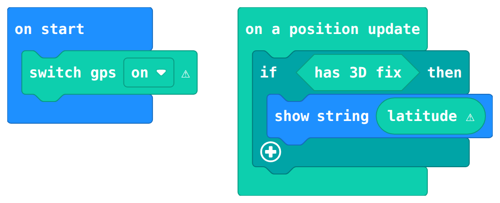</x-photo>
:::

::: typescript
```typescript
RibBitGPS.switchGPS( RibBit.OnOff.On )
RibBitGPS.onPositionUpdate( function () {
    if( RibBitGPS.has3DFix() ) {
        basic.showString( "" + RibBitGPS.getLatitude() )
    }
} )
```
:::

</div>
</x-example>

<x-example>
<div>

### Show the time

Show the time reported by the satellites each time it updates.

</div>
<div>

::: blocks
<x-photo>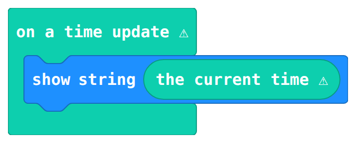</x-photo>
:::

::: typescript
```typescript
RibBitGPS.onTimeUpdate( function () {
    basic.showString( RibBitGPS.getTime() )
} )
```
:::

</div>
</x-example>

## Block reference

| Block | What it does |
| --- | --- |
| :blocks[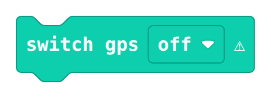] :typescript[`RibBitGPS.switchGPS( state )`] | Turns the GPS receiver on or off. |
| :blocks[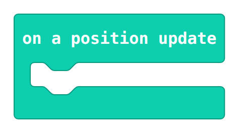] :typescript[`RibBitGPS.onPositionUpdate( cb )`] | Runs your blocks whenever a new position arrives. |
| :blocks[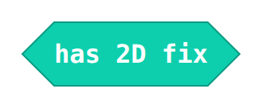] :typescript[`RibBitGPS.has2DFix()`] | True when there is a 2D fix (latitude and longitude). |
| :blocks[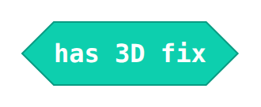] :typescript[`RibBitGPS.has3DFix()`] | True when there is a 3D fix (latitude, longitude and altitude). |
| :blocks[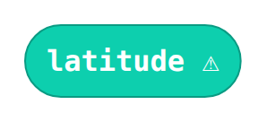] :typescript[`RibBitGPS.getLatitude()`] | The current latitude. |
| :blocks[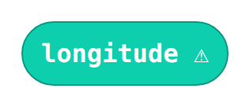] :typescript[`RibBitGPS.getLongitude()`] | The current longitude. |
| :blocks[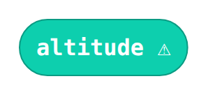] :typescript[`RibBitGPS.getAltitude()`] | The current altitude. |
| :blocks[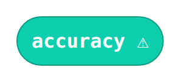] :typescript[`RibBitGPS.getAccuracy()`] | The estimated accuracy of the position. |
| :blocks[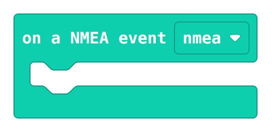] :typescript[`RibBitGPS.onNEMAData( cb )`] | Runs your blocks for every raw NMEA sentence the receiver sends. |
| :blocks[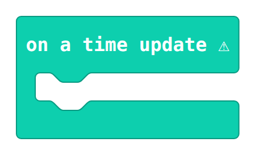] :typescript[`RibBitGPS.onTimeUpdate( cb )`] | Runs your blocks whenever the GPS time updates. |
| :blocks[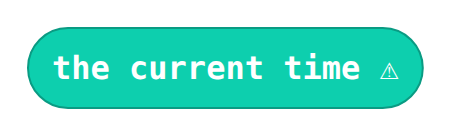] :typescript[`RibBitGPS.getTime()`] | The current GPS time, as text. |
| :blocks[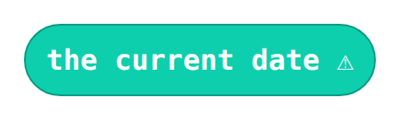] :typescript[`RibBitGPS.getDate()`] | The current GPS date, as text. |
| :blocks[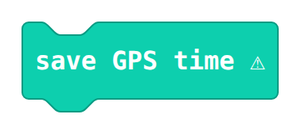] :typescript[`RibBitGPS.saveGPSTime()`] | Saves the current GPS time to the device. |

### Advanced blocks

These are found under **Advanced** in the Rib:bit GPS drawer, and most projects will not need them.

| Block | What it does |
| --- | --- |
| :blocks[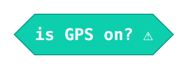] :typescript[`RibBitGPS.isGPSOn()`] | True while the GPS receiver is powered on. |
| :blocks[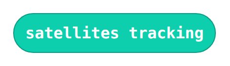] :typescript[`RibBitGPS.satellites()`] | How many satellites are currently being tracked. |
| :blocks[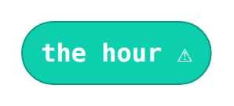] :typescript[`RibBitGPS.getHour()`] | The hour of the GPS time, as a number. |
| :blocks[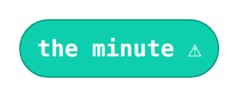] :typescript[`RibBitGPS.getMinute()`] | The minute of the GPS time, as a number. |
| :blocks[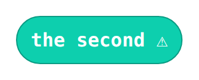] :typescript[`RibBitGPS.getSecond()`] | The second of the GPS time, as a number. |
| :blocks[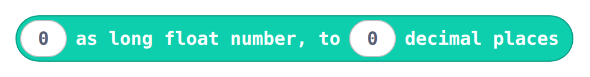] :typescript[`RibBitGPS.toLongFloatString( v, precision )`] | Turns a number into text with the chosen number of decimal places (8 by default), so no digits of a coordinate are lost. |

## More resources

- TypeScript namespace docs: [Rib:bit GPS Namespace](namespace_ribbitgps/)
- TypeScript enum docs: [Location Fix Type Enum](enum_locationfixtype/)
